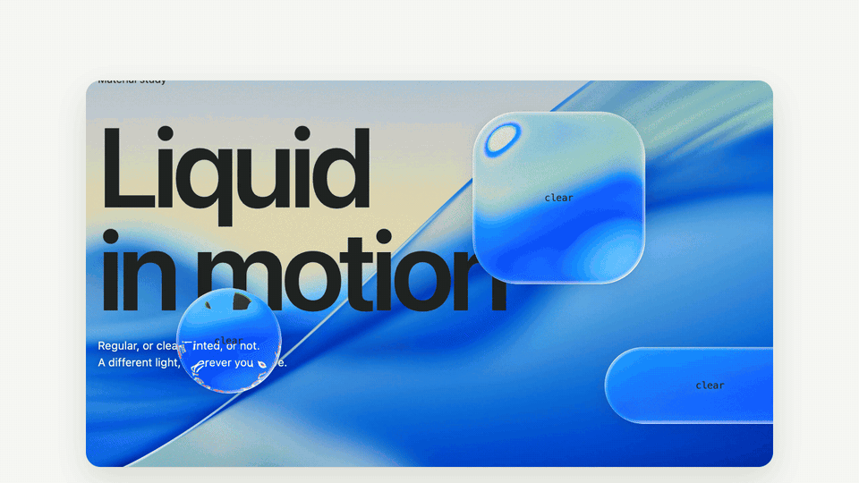

<p align="center">
  
</p>

<h1 align="center">Liquid Glass for React</h1>

<p align="center">
  Apple's iOS 26 and macOS 26 <b>Liquid Glass</b> for the web.<br/>
  Physically based refraction, a specular rim and touch-reactive glass, without WebGL.
</p>

<p align="center">
  <a href="https://www.npmjs.com/package/@vepando/liquid-glass-react"></a>
  <a href="https://bundlephobia.com/package/@vepando/liquid-glass-react"></a>
  
  
</p>

<p align="center">
  <a href="https://leonardseo.github.io/liquid-glass-react/"><b>Live demo</b></a> ·
  <a href="https://leonardseo.github.io/liquid-glass-react/?scene=ui">Components</a> ·
  <a href="#quick-start">Quick start</a> ·
  <a href="#examples">Examples</a> ·
  <a href="#how-it-works">How it works</a>
</p>

---

Most "liquid glass" on the web is `backdrop-filter: blur()` in a rounded box.
Real Liquid Glass **bends light**: the centre stays clear while the curved rim
magnifies what is behind it and catches a bright edge.

This library models that rim as a lens. It traces light through it with
Snell's law, writes the result into an SVG displacement map sized to each
element, and lets the browser apply it in its normal `backdrop-filter` pass.
Nothing runs per frame.

<p align="center">
  
</p>

## Two ways to use it

| | **The engine** | **The components** |
| --- | --- | --- |
| What | `<LiquidGlass>` and `useLiquidGlass`: glass for any element | Switch, Slider, Menu, Tab Bar and more, modelled on iOS 26 |
| Install | `npm install @vepando/liquid-glass-react` | `npx shadcn@latest add …` (copies the source into your project) |
| Needs | React 18+ | React 18+, a shadcn setup, Base UI for some components |
| Use when | You build your own glass UI | You want ready-made, accessible controls you can edit |

## Quick start

```bash
npm install @vepando/liquid-glass-react
```

```tsx
import "@vepando/liquid-glass-react/style.css" // once, e.g. in your root layout
import { LiquidGlass } from "@vepando/liquid-glass-react"

export function Navbar() {
  return (
    <LiquidGlass radius={999} style={{ height: 64 }}>
      <nav>…</nav>
    </LiquidGlass>
  )
}
```

Works in Next.js App Router out of the box: the bundle is marked
`"use client"` and renders a frosted fallback on the server.

## Examples

**A floating navigation bar.** Frosted `regular` glass, the default, keeps text
readable over anything.

```tsx
<LiquidGlass radius={999} style={{ position: "fixed", top: 16, left: "50%", translate: "-50%", padding: "8px 20px" }}>
  <nav style={{ display: "flex", gap: 24 }}>
    <a href="/">Home</a>
    <a href="/docs">Docs</a>
    <a href="/blog">Blog</a>
  </nav>
</LiquidGlass>
```

**Clear glass over a photo.** `clear` drops the frost, so the rim bends the image
behind it. Keep text on it short and bold.

```tsx
<div style={{ position: "relative", backgroundImage: "url(/photo.jpg)", backgroundSize: "cover", height: 420 }}>
  <LiquidGlass variant="clear" radius={28} style={{ position: "absolute", left: 24, bottom: 24, padding: "16px 20px" }}>
    <strong>Lake Tahoe</strong>
  </LiquidGlass>
</div>
```

**A button that is really a button.** `render` puts the glass on your own element,
so it keeps keyboard focus and activation.

```tsx
<LiquidGlass radius={999} interactive render={<button type="button" onClick={play} />} style={{ width: 56, height: 56 }}>
  <PlayIcon aria-hidden="true" />
</LiquidGlass>
```

**A settings panel from the components.** The same lens drives the segmented
control, the switches and the slider.

```tsx
<GlassSegmentedControl aria-label="Appearance" value={theme} onValueChange={setTheme}
  items={[{ value: "light", label: "Light" }, { value: "dark", label: "Dark" }, { value: "auto", label: "Automatic" }]} />

<div className="row">Wi-Fi <GlassSwitch aria-label="Wi-Fi" checked={wifi} onCheckedChange={setWifi} /></div>

<GlassSlider aria-label="Brightness" value={brightness} onValueChange={setBrightness} />
```

**A toolbar with a menu.** The menu grows out of the toolbar button and keeps a
glass backdrop of its own.

```tsx
<GlassToolbar aria-label="Browser">
  <GlassToolbarButton aria-label="Back"><Back /></GlassToolbarButton>
  <GlassToolbarSeparator />
  <GlassMenu>
    <GlassMenuTrigger render={<GlassToolbarButton aria-label="Tabs" />}><Tabs /></GlassMenuTrigger>
    <GlassMenuContent side="top" align="end">
      <GlassMenuItem icon={<Plus />}>New Tab</GlassMenuItem>
      <GlassMenuSeparator />
      <GlassMenuItem destructive icon={<Close />}>Close All Tabs</GlassMenuItem>
    </GlassMenuContent>
  </GlassMenu>
</GlassToolbar>
```

The settings panel and the toolbar with its menu run in the
[showcase](https://leonardseo.github.io/liquid-glass-react/?page=showcase).

## Components

Ready-made controls that install as source through the
[shadcn](https://ui.shadcn.com) CLI, so they live in your project and you can
change them. Each one is keyboard and screen reader accessible, themes through
CSS variables and follows light and dark mode.

| Component | | Install name |
| --- | --- | --- |
| **Button** | Primary and secondary glass buttons, with loading and disabled states | `glass-button` |
| **Switch** | The iOS 26 switch: the capsule lifts into a glass lens as it toggles | `glass-switch` |
| **Slider** | A thin track whose thumb becomes a lens while dragged, stretching past the ends | `glass-slider` |
| **Segmented Control** | A white pill that rises into a lens you can drag between segments | `glass-segmented-control` |
| **Tab Bar** | A floating tab bar or site navigation with a draggable magnifying lens | `glass-tab-bar` |
| **Tabs** | Tabs with panels and a moving glass indicator | `glass-tabs` |
| **Toolbar** | A group of actions on one shared glass capsule | `glass-toolbar` |
| **Input** | A text field on glass with an icon and clear button, such as a search field | `glass-input` |
| **Menu** | A menu that morphs out of its button and shrinks back into it | `glass-menu` |
| **Dialog** | A modal on a readable glass surface | `glass-dialog` |
| **Card** | A glass panel with header, content and footer | `glass-card` |

```bash
npx shadcn@latest add https://leonardseo.github.io/liquid-glass-react/r/glass-switch.json
```

Replace `glass-switch` with any install name above; several URLs can go in
one command. Shared pieces (the design tokens and the lens physics) come along
automatically. This needs a project set up for shadcn with Tailwind CSS v4.

```tsx
<GlassButton variant="primary">Save</GlassButton>

<GlassSwitch aria-label="Wi-Fi" checked={wifi} onCheckedChange={setWifi} />

<GlassSlider aria-label="Volume" value={volume} onValueChange={setVolume} />

<GlassSegmentedControl aria-label="View" value={view} onValueChange={setView}
  items={[{ value: "day", label: "Day" }, { value: "week", label: "Week" }]} />

<GlassTabBar aria-label="Sections" value={tab} onValueChange={setTab} items={items} />

<GlassInput type="search" placeholder="Search" icon={<Search />} clearable />

<GlassMenu>
  <GlassMenuTrigger render={<GlassButton size="icon" aria-label="More" />}><Ellipsis /></GlassMenuTrigger>
  <GlassMenuContent align="end">
    <GlassMenuItem icon={<Copy />}>Copy</GlassMenuItem>
    <GlassMenuSeparator />
    <GlassMenuItem destructive icon={<Trash />}>Delete</GlassMenuItem>
  </GlassMenuContent>
</GlassMenu>
```

See every component, in light and dark, at the
[component demo](https://leonardseo.github.io/liquid-glass-react/?scene=ui).

### Theming

The tokens come along in `components/ui/glass-tokens.css`. Change the
variables there to restyle every component. Dark mode follows a `.dark` class
or `data-theme="dark"` on `<html>` or on any container, so one panel can be
dark on a light page.

Surfaces use Apple's glass materials:

| Material | Used for | Character |
| --- | --- | --- |
| `regular` | Buttons, tabs, cards, dialogs, menus | Frosted and bright, for surfaces with text |
| `bar` | The tab bar | A light frost; the backdrop stays recognisable |
| `clear` | Glass over rich media | See-through with a refracting rim |

**One layer of glass per stack.** A `backdrop-filter` hides the page from
everything inside it, so glass nested in glass has nothing to refract. The
components handle this: a `GlassButton` inside a card, dialog or toolbar
becomes inset glass, and a menu opened from a toolbar is portalled out so it
keeps a backdrop of its own.

## API

### `<LiquidGlass>`

Set the size with CSS and pick the glass:

| Prop | Default | Description |
| --- | --- | --- |
| `variant` | `"regular"` | `"regular"` (frosted, matched against macOS's `NSGlassEffectView`), `"clear"` (see-through, bends what is behind it) or `"identity"` (no glass) |
| `radius` | `32` | Corner radius in px; `999` for pills and circles; `"auto"` reads the CSS `border-radius` |
| `tint` | none | Any CSS colour, ideally translucent |
| `interactive` | `false` | Press-to-grow and a touch glow, for controls |
| `render` | | Render as another element, e.g. `render={<button type="button" />}` |

Every other `div` prop is passed through, and `ref` reaches the element.
`interactive` adds the animation only: put a native button or link inside, or
use `render`, for keyboard access.

### `useLiquidGlass`

The engine without the `div`, for Base UI, Radix or your own markup. It takes
the same options, with `radius` defaulting to `"auto"`.

```tsx
import { Button } from "@base-ui/react/button"
import { useLiquidGlass } from "@vepando/liquid-glass-react"

function GlassButton({ children }) {
  const glass = useLiquidGlass()
  return (
    <Button ref={glass.ref} {...glass.rootProps} className={`${glass.rootProps.className} rounded-full`}>
      {glass.wrap(children)}
    </Button>
  )
}
```

`ref` must reach the DOM element and `wrap` must be its only child. Merge your
own `className`, `style` and pointer handlers with `rootProps`.

## How it works


1. **Optics.** Across the rim, the slope of a squircle profile gives a surface
   normal. A view ray is refracted at n = 1.5 and followed to the content
   below. Its sideways offset is the displacement: zero in the flat centre,
   large near the edge.
2. **Map.** That curve is swept around the element's rounded outline and
   encoded into an image, generated for the element's measured size and
   shared between elements of the same size.
3. **Compositing.** The map drives an SVG `feDisplacementMap` referenced from
   `backdrop-filter`. A masked tint, an angle-dependent specular rim and your
   content sit on top.

The full derivation is in
[`skills/liquid-glass/references/theory.md`](skills/liquid-glass/references/theory.md).
The refraction model follows kube.io's
[*Liquid Glass in the browser*](https://kube.io/blog/liquid-glass-css-svg/).

## Browser support

| Engine | Result |
| --- | --- |
| **Chromium**: Chrome, Edge, Arc, Brave, Opera | Full effect: refraction, specular rim, frost |
| **WebKit**: Safari and every iOS browser | Frosted fallback: blur, tint and specular rim |
| **Gecko**: Firefox | Frosted fallback |

Only Chromium renders SVG filters inside `backdrop-filter`, so the library
detects it and adds the refraction there only. Everything respects
`prefers-reduced-transparency`, `prefers-contrast`, `forced-colors` and
`prefers-reduced-motion`.

## Troubleshooting

**The page shows through without any bending.** An ancestor is cutting off
the backdrop. `filter`, `opacity` below 1, `mask`, `clip-path`,
`mix-blend-mode` or another `backdrop-filter` on an ancestor all do this;
`transform` and `overflow: hidden` are fine.

**Glass inside glass looks flat.** The inner glass cannot see past the outer
one. Place it as a sibling on top instead of as a child.

**The glass disappeared after a build.** Don't declare `backdrop-filter` on
`.lg` in your own CSS: some minifiers collapse it to the prefixed form only,
which Chromium ignores. Set `--lg-backdrop-override` instead.

**It looks like a tinted rectangle.** Glass needs something to bend: it shows
over images, text and edges, not over a flat colour.

<details>
<summary><b>Performance notes</b></summary>

Maps are built once per distinct size and shared, so a page of uniform
controls is cheap. New sizes are generated synchronously: fifty different
sizes at once take about 225 ms under 4× CPU throttling. Large panels and
continuous resizing cost the most, and the SVG backdrop is redrawn every frame
by the browser.

</details>

<details>
<summary><b>Static, zero-JS variant</b></summary>

For fixed-size elements, a Python script writes the displacement map as a PNG
and prints the matching `scale`:

```bash
pip install -r skills/liquid-glass/scripts/requirements.txt
python3 skills/liquid-glass/scripts/generate-displacement-map.py --width 700 --height 64 --radius 32 \
  --output public/liquid-lens-map.png
```

Generate the map at the element's exact CSS size; a stretched map puts the
bend in the wrong place.

</details>

<details>
<summary><b>For AI coding agents</b></summary>

[`skills/liquid-glass/`](skills/liquid-glass) is a self-contained skill (a
`SKILL.md`, the source and the theory) that you can give to Claude Code or
another coding agent to build the effect end to end, including a table of
common failure modes.

</details>

## Development

```bash
npm install
npm test                # geometry and component tests (Node 22.18+ or 24+)
npm run typecheck
npm run build           # tsup → dist/ (ESM, CJS, types, style.css)
npm run registry:build  # shadcn registry → demo/public/r
npm run skill:sync      # copies src/ into the skill; tests fail if it is stale
cd demo && npm install && npm run dev
```

| Path | Contents |
| --- | --- |
| `src/` | The npm package: component, hook, optics and `liquid-glass.css` |
| `registry/glass/` | The shadcn components; `registry.json` lists them |
| `demo/` | The Vite demo site, deployed to GitHub Pages from `main` |
| `skills/liquid-glass/` | The skill for AI coding agents |

The demo imports the package by name and Vite points that name at `src/`, so
changes to the library reload instantly. `?scene=ui` shows the components and
`?scene=bench` is the performance page.

## Credits and license

Liquid Glass is a design language by Apple; this project is not affiliated
with Apple. The macOS Tahoe wallpapers in the demo and in `docs/` are Apple's,
are only used for the demo, and are not covered by this project's license or
included in the npm package.

[MIT](LICENSE) © Leonard van Hemert
