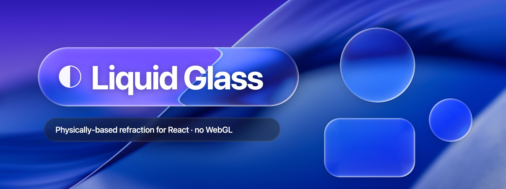
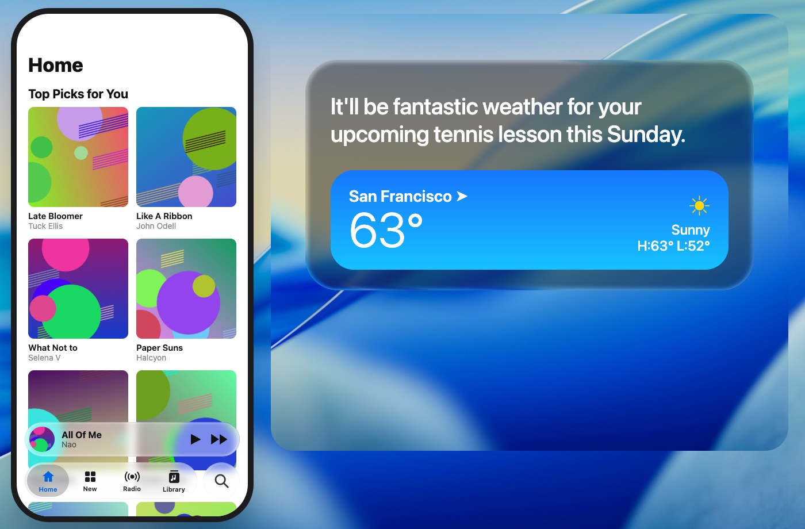
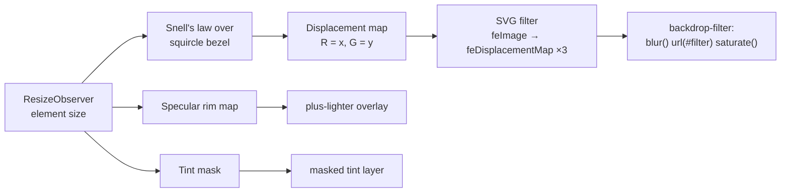

<p align="center">
  
</p>

<h1 align="center">Liquid Glass for React</h1>

<p align="center">
  Apple's iOS 26 / macOS 26 <b>Liquid Glass</b> material for the web.<br/>
  Physically based refraction, a specular rim and touch-reactive glass.<br/>
  No WebGL, no canvas snapshots, no per-frame JavaScript.
</p>

<p align="center">
  <a href="https://www.npmjs.com/package/@vepando/liquid-glass-react"></a>
  <a href="https://bundlephobia.com/package/@vepando/liquid-glass-react"></a>
  
  
  
  
  
</p>

<p align="center">
  <strong>Try the live demo — no installation needed</strong><br/>
  <a href="https://leonardseo.github.io/liquid-glass-react/">https://leonardseo.github.io/liquid-glass-react/</a>
</p>

---

Most "liquid glass" CSS on the web is `backdrop-filter: blur()` in a
rounded box. Real Liquid Glass **bends light**: the centre stays clear,
while the curved rim magnifies and stretches whatever is behind it and
catches a bright edge highlight.

This library models that rim as an actual lens. It traces light through
it with **Snell's law**, writes the result into an SVG displacement map
sized to each element, and lets the browser apply it in its normal
`backdrop-filter` pass. `variant="clear"` shows that lens at full strength;
the default `regular` is frosted like Apple's system glass.

```bash
npm install @vepando/liquid-glass-react
```

```tsx
import "@vepando/liquid-glass-react/style.css"
import { LiquidGlass } from "@vepando/liquid-glass-react"

<LiquidGlass radius={999} interactive style={{ height: 64 }}>
  <nav>…</nav>
</LiquidGlass>
```

<p align="center">
  
</p>

## Contents

- [Features](#features)
- [Install](#install)
- [Usage](#usage)
- [UI components](#ui-components)
- [Props](#props)
- [Building your own components](#building-your-own-components)
- [How it works](#how-it-works)
- [Browser support](#browser-support)
- [Gotchas](#gotchas)
- [Static / zero-JS variant](#static--zero-js-variant)
- [Demo](#demo)
- [Credits](#credits)

## Features

- **Physically based refraction.** The rim is a convex squircle bezel.
  Rays are refracted at n = 1.5 and traced down to the content beneath.
  The centre stays undistorted and the rim magnifies.
- **Pixel-exact maps per element.** Each map is generated for the
  element's measured size and regenerated on resize, so the bend sits
  right on the curve whatever the shape.
- **Clear rim, tinted centre.** The tint fades out across the bezel, so
  the refracted backdrop shows bright at the edge, as in Apple's glass.
- **Angle-dependent specular.** A crisp edge line plus a soft inner glow
  that follows a configurable light direction.
- **Regular and clear.** `regular` is frosted and matched against macOS's
  system glass. `clear` is see-through and bends what is behind it.
- **Chromatic dispersion.** On `clear`, R, G and B bend by slightly different
  amounts for a faint colour fringe on high-contrast edges.
- **Touch interaction.** `interactive` adds a springy press-to-grow and a
  glow from the touch point.
- **Light and dark.** Glass follows a `dark` class or `data-theme="dark"`,
  and `tint` takes any CSS colour.
- **SSR safe.** A frosted fallback renders on the server and upgrades on
  mount, without hydration mismatches.
- **Cached maps.** Identical controls share maps. New sizes and optical
  settings generate maps synchronously; large panels and continuous
  resizing can be expensive. SVG backdrop rendering still costs work
  every frame, especially with dispersion.
- **Zero dependencies.** React 18+ is the only peer dependency. ESM +
  CJS + TypeScript types, about 8 KB gzipped including the CSS.

## Install

```bash
npm install @vepando/liquid-glass-react
# or: pnpm add @vepando/liquid-glass-react · yarn add @vepando/liquid-glass-react · bun add @vepando/liquid-glass-react
```

Import the stylesheet **once**, e.g. in your root layout or entry file:

```tsx
import "@vepando/liquid-glass-react/style.css"
```

Then use the component anywhere:

```tsx
import { LiquidGlass } from "@vepando/liquid-glass-react"
```

**Next.js App Router:** the bundle is already marked `"use client"`, so
you can render `<LiquidGlass>` straight from a server component. Put the
CSS import in `app/layout.tsx`. Tested with `next build` and React 18/19
SSR.

**Prefer to own the code?** The source is in [`src/`](src).
The copy-paste version in
[`skills/liquid-glass/assets/`](skills/liquid-glass/assets) works without
the package.

## Usage

**Floating navbar**

```tsx
<LiquidGlass radius={999} className="h-16 w-full max-w-3xl">
  <nav className="h-full flex items-center justify-between px-6">…</nav>
</LiquidGlass>
```

**Round icon button**

```tsx
<LiquidGlass radius={999} interactive className="h-16 w-16">
  <button type="button" aria-label="Search" onClick={openSearch}
    className="h-full w-full rounded-full border-0 bg-transparent cursor-pointer focus-visible:outline focus-visible:outline-2 focus-visible:outline-offset-2">
    <SearchIcon aria-hidden="true" />
  </button>
</LiquidGlass>
```

`interactive` adds a pointer animation to a `div`; it does not turn it
into a button. Put a native button or link inside for keyboard access,
activation and focus. The utility classes in these examples assume
Tailwind; equivalent CSS works too.

**Dark sheet / panel**

```tsx
<LiquidGlass radius={56} className="dark p-12">
  <p className="text-white text-4xl">It'll be fantastic weather…</p>
</LiquidGlass>
```

**Glass on glass (e.g. a tab bar selection droplet).** Render the inner
glass as a *sibling* positioned over the outer one, not as a child (see
[Gotchas](#gotchas)):

```tsx
<div className="relative">
  <LiquidGlass radius={999} className="h-16">{tabs}</LiquidGlass>
  <div className="absolute inset-1 pointer-events-none">
    <LiquidGlass variant="clear" radius={999}
      style={{ width: "25%", height: "100%", transform: `translateX(${active * 100}%)` }} />
  </div>
</div>
```

For a complete draggable version, use [`GlassTabBar`](#ui-components).

## UI components

Ready-made, themeable components for real apps: **Button, Switch, Tabs, Tab
Bar, Dialog and Card**. Button, Tabs and Dialog use
[Base UI](https://base-ui.com) for keyboard and screen reader behaviour. All
of them install as source code through the [shadcn](https://ui.shadcn.com)
CLI, so they live in your project and you (or your coding agent) can change
them.

```bash
npx shadcn@latest add https://leonardseo.github.io/liquid-glass-react/r/glass-button.json
npx shadcn@latest add https://leonardseo.github.io/liquid-glass-react/r/glass-switch.json
npx shadcn@latest add https://leonardseo.github.io/liquid-glass-react/r/glass-tabs.json
npx shadcn@latest add https://leonardseo.github.io/liquid-glass-react/r/glass-tab-bar.json
npx shadcn@latest add https://leonardseo.github.io/liquid-glass-react/r/glass-dialog.json
npx shadcn@latest add https://leonardseo.github.io/liquid-glass-react/r/glass-card.json
```

This needs a project set up for shadcn with Tailwind CSS v4. The tokens
come along in `components/ui/glass-tokens.css`: change the variables there
to theme everything, including dark mode through a `.dark` class or
`data-theme="dark"` on `<html>`.

```tsx
import { GlassButton } from "@/components/ui/glass-button"

<GlassButton variant="primary">Save</GlassButton>
<GlassButton loading>Saving</GlassButton>
```

`GlassTabBar` is an iOS-style tab bar or navigation: a quiet pill at rest, and
a magnifying lens you can drag between items. Give items an `href` for a
navigation; without one they become tabs with arrow-key support.

```tsx
<GlassTabBar aria-label="Sections" value={tab} onValueChange={setTab} items={items} />
```

`GlassSwitch` is the iOS 26 switch: a white capsule that lifts into a clear
glass lens when pressed, stays glass while held and turns white again once it
has slid across. Use `checked` and `onCheckedChange`, or `defaultChecked`; give
it a `name` to submit it with a form.

```tsx
<GlassSwitch aria-label="Wi-Fi" checked={wifi} onCheckedChange={setWifi} />
```

Materials follow Apple's glass styles:

| Material | Used for | Character |
| --- | --- | --- |
| `regular` | Default for buttons, tabs, cards and dialogs | Frosted and bright, for controls and surfaces with text |
| `bar` | Default for `GlassTabBar` | Light frost, the backdrop stays recognisable |
| `clear` | Glass over rich media | See-through, with a refracting rim. Check that text on it stays legible |

**One layer of glass per stack.** A `backdrop-filter` hides the page from
everything inside it, so glass nested in glass has nothing to refract.
`GlassCard` and `GlassDialogContent` handle this for you: a `GlassButton`
inside them switches to inset glass, which keeps the rim and tint but has no
backdrop of its own. For the same reason the track of `GlassTabsList` is not
glass, so the indicator moving over it can refract.

**Performance.** Maps are built once per distinct size and shared, so a page of uniform controls is cheap.
Fifty *different* sizes at once take noticeably longer on slow devices (about
225 ms under 4× CPU throttling, in one block on first render).

## Props

Set the size with CSS and choose from the same options Apple's glass offers:

| Prop | Default | Description |
| --- | --- | --- |
| `variant` | `"regular"` | Glass style: `"regular"` (frosted, matched against macOS's `NSGlassEffectView`), `"clear"` (see-through, bends what is behind it) or `"identity"` (no glass). Add a `dark` class or `data-theme="dark"` on the glass or an ancestor for dark mode. |
| `radius` | `32` | Corner radius in px. `999` for pills and circles. `"auto"` reads the CSS `border-radius`, so `rem` and tokens work. |
| `tint` | none | Any CSS colour, ideally translucent. |
| `interactive` | `false` | Press-to-grow and touch glow, for controls. |
| `render` | - | Render as another element, e.g. `render={<button type="button" />}`. |

Every other `div` prop (`className`, `style`, `onClick`, `role`, …) is
passed through, and `ref` reaches the element.

## Building your own components

`useLiquidGlass` gives you the engine without the `div`, for use with Base UI,
Radix or your own markup. It takes the same options as the props above, with
`radius` defaulting to `"auto"`.

```tsx
import { Button } from "@base-ui/react/button"
import { useLiquidGlass } from "@vepando/liquid-glass-react"

function GlassButton({ children }) {
  const glass = useLiquidGlass()
  return (
    <Button ref={glass.ref} {...glass.rootProps} className={`${glass.rootProps.className} rounded-full`}>
      {glass.wrap(children)}
    </Button>
  )
}
```

`ref` must reach the DOM element, and `wrap` must be its only child. If you
pass your own `className`, `style` or pointer handlers, merge them with
`rootProps` (Base UI's `mergeProps` does this).

### Responsive layout and geometry

Width and height can use `rem`, `%`, `vw`, grid or flex layouts. The
component measures the border box in CSS pixels and regenerates its maps
when that box changes, including padding and borders. CSS pixels are the
coordinate system of the generated filter, not physical device pixels.

```tsx
<LiquidGlass radius={999} style={{ width: "100%", maxWidth: "40rem", height: "4rem" }}>
  <nav>…</nav>
</LiquidGlass>
```

## How it works



1. **Optics.** For each distance across the bezel, the surface slope of
   the squircle profile gives a normal. A straight-down view ray is
   refracted into the glass and followed to the content plane. The
   sideways offset is the displacement: 0 on the flat plateau, large near
   the edge.
2. **Map.** That 1-D curve is swept around the rounded-rect outline along
   the inward normal and encoded into R/G, where 128 means no shift.
   `feDisplacementMap` then samples the backdrop from further inside the
   glass near the rim, which reads as magnification.
3. **Compositing.** The filter is referenced from `backdrop-filter` on the
   component root. A masked tint, the specular map
   (`mix-blend-mode: plus-lighter`) and your content sit on top.

The deep dive is in
[`skills/liquid-glass/references/theory.md`](skills/liquid-glass/references/theory.md).

## Browser support

| Engine | Result |
| --- | --- |
| **Blink**: Chrome, Edge, Arc, Brave, Opera | Full effect: refraction, dispersion, specular, frost |
| **WebKit**: Safari and every iOS browser | Frosted fallback: blur, tint and specular rim, no refraction |
| **Gecko**: Firefox | Same frosted fallback |

The stylesheet also responds to `prefers-reduced-transparency` (solid
surface), `prefers-contrast: more` (near-opaque surface with a visible edge),
`forced-colors` and `prefers-reduced-motion`.

Only Blink renders SVG filters referenced from `backdrop-filter`. The
other engines accept the syntax but draw nothing, so a CSS cascade
fallback isn't reliable there. The component detects Blink and only adds
`url(#filter)` there.

## Gotchas

> **No refraction at all, the page just shows through the glass?** You
> have a *backdrop root* in the way.

- An ancestor with `filter`, `opacity < 1`, `mask`, `clip-path`,
  `mix-blend-mode`, `backdrop-filter`, or children that blend into it,
  cuts the backdrop off at that ancestor. The glass then refracts an empty
  image. That's why `backdrop-filter` sits on the component root, never on
  an inner layer. `transform` and `overflow: hidden` are fine.
- **Glass inside glass can't see the outer glass's refraction.** Use
  siblings positioned on top (see [Usage](#usage)).
- **Don't declare `backdrop-filter` on `.lg` in your own CSS.** Minifiers
  such as Lightning CSS (the Vite 8 default) can collapse a
  `backdrop-filter` and `-webkit-backdrop-filter` pair with equal values to
  the prefixed one alone, which Chromium ignores. To replace the filter, set
  `--lg-backdrop-override` instead.
- **Give the glass something to bend.** Over a flat colour, any glass
  looks like a tinted rectangle. Refraction shows over images, text and
  edges.

## Static / zero-JS variant

For fixed-size elements, the same optics are available as a Python script
that writes a PNG and prints the matching `scale`:

```bash
pip install -r skills/liquid-glass/scripts/requirements.txt
python3 skills/liquid-glass/scripts/generate-displacement-map.py --width 700 --height 64 --radius 32 \
  --output public/liquid-lens-map.png
# → Use it with: <feDisplacementMap scale="24.0" xChannelSelector="R" yChannelSelector="G" />
```

Generate the map at the element's **exact** CSS size; a stretched map
puts the bend in the wrong place.

## Demo

**[Open the live demo](https://leonardseo.github.io/liquid-glass-react/)** — no installation required.

[Glass lab](https://leonardseo.github.io/liquid-glass-react/?page=lab) ·
[Showcase](https://leonardseo.github.io/liquid-glass-react/?page=showcase)

Chromium shows the full refraction effect; other browsers get the frosted
fallback. The demo deploys to GitHub Pages after successful checks on `main`.

To run locally:

```bash
cd demo
npm install
npm run dev
```

| URL | Scene |
| --- | --- |
| `/` | Homepage with draggable glass and links to all demos |
| `/?page=lab` | Squircle, orb and pill lenses; draggable with mouse, touch or arrow keys; live backdrop, style, tint, interactive and corner radius controls |
| `/?page=showcase` | Interactive artwork gallery, music interface and weather panel |
| `/?scene=music` | Apple Music style app with a draggable tab bar, mini player and search button over album art |
| `/?scene=siri` | Dark glass panel over the macOS Tahoe wallpaper |
| `/?scene=playground` | Draggable glass over text on the wallpaper |
| `/?scene=banner` | The header image of this README |

The demo imports `@vepando/liquid-glass-react` by name; Vite aliases that name to
`src/`, so you get HMR on the library source without a build step.

## For AI coding agents

[`skills/liquid-glass/`](skills/liquid-glass) is a self-contained skill
(`SKILL.md`, assets and theory) that you can hand to Claude Code or any
other coding agent to implement the effect end-to-end, including the
troubleshooting table for the common failure modes.

## Repository layout

```
src/                  the package: components, hook, variants, optics maps and liquid-glass.css
registry/glass/       source of the UI components; registry.json lists them for the shadcn CLI
dist/                 build output (npm run build), published to npm
demo/                 Vite + React showcase
scripts/              sync-skill.mjs (regenerates the skill's copy of src/)
skills/liquid-glass/  skill for AI coding agents
docs/                 images used in this README
```

## Credits

The refraction model follows the approach described by kube.io in
[*Liquid Glass in the browser: refraction with CSS and SVG*](https://kube.io/blog/liquid-glass-css-svg/).
Liquid Glass is a design language by Apple; this project is not
affiliated with Apple.

The macOS Tahoe wallpapers in `demo/public/img/` and in the images in `docs/`
are Apple's. They are only used for the demo and are not covered by this
project's MIT license or included in the npm package.

## Development

```bash
npm install
npm run build      # tsup → dist/ (ESM, CJS, .d.ts, style.css)
npm run typecheck
npm test           # geometry and component tests; Node 22.18+ or 24+
npm run registry:build  # shadcn registry → demo/public/r
npm run skill:sync      # copies src/ into the skill; tests fail if it is stale
cd demo && npm install && npm run dev
```

The components are at `?scene=ui` in the demo, and `?scene=bench&mode=dense`
(also `same`, `varied`, `panel`, `move`, `resize`, `scroll`, `nest`) is the
measuring page.

Publishing: `npm publish` (runs typecheck and build first via
`prepublishOnly`).

## License

[MIT](LICENSE)
